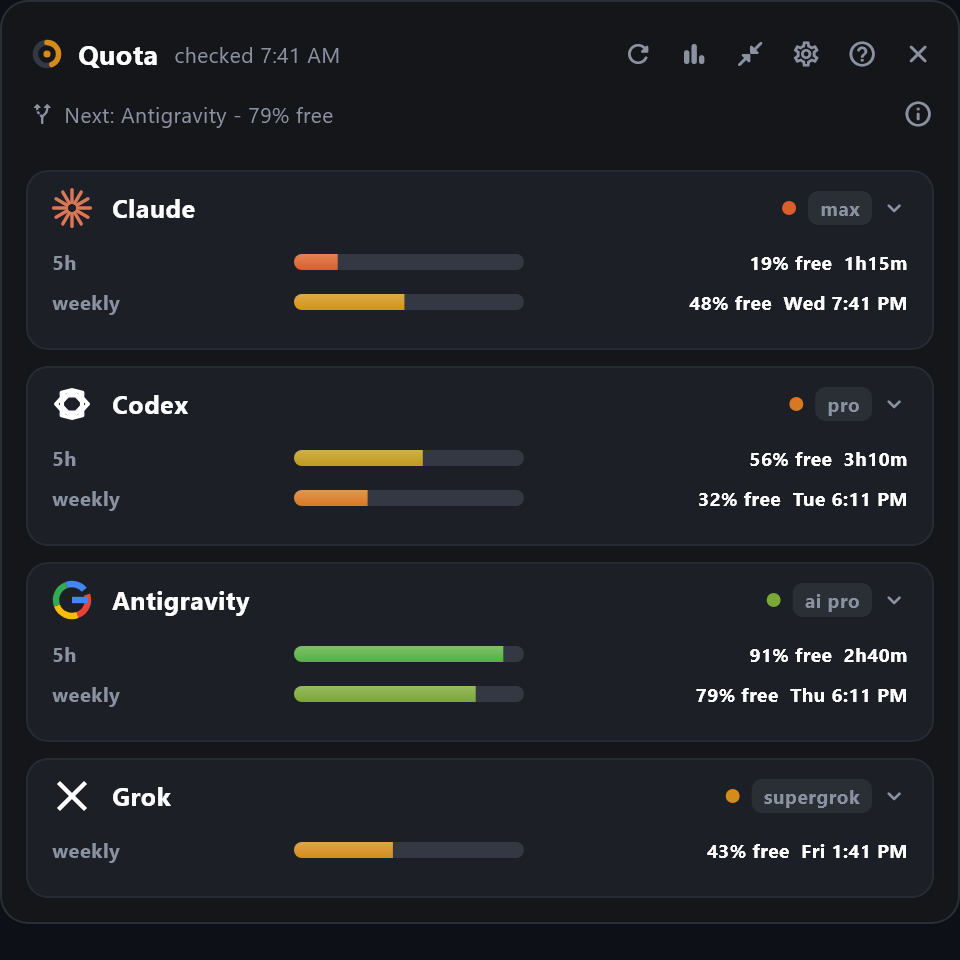
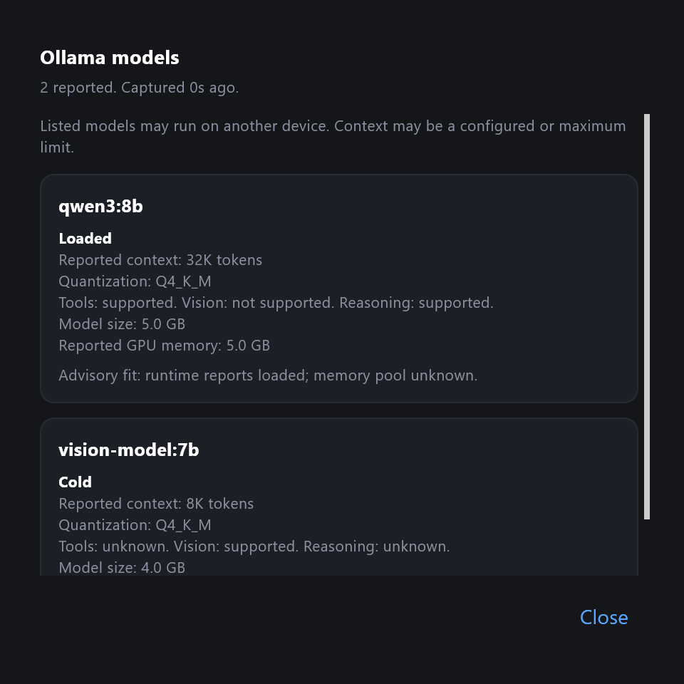
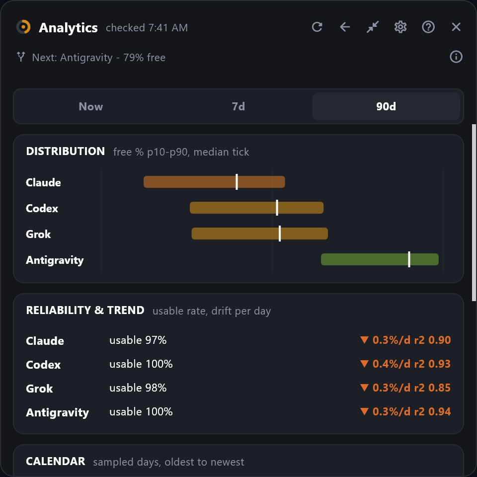
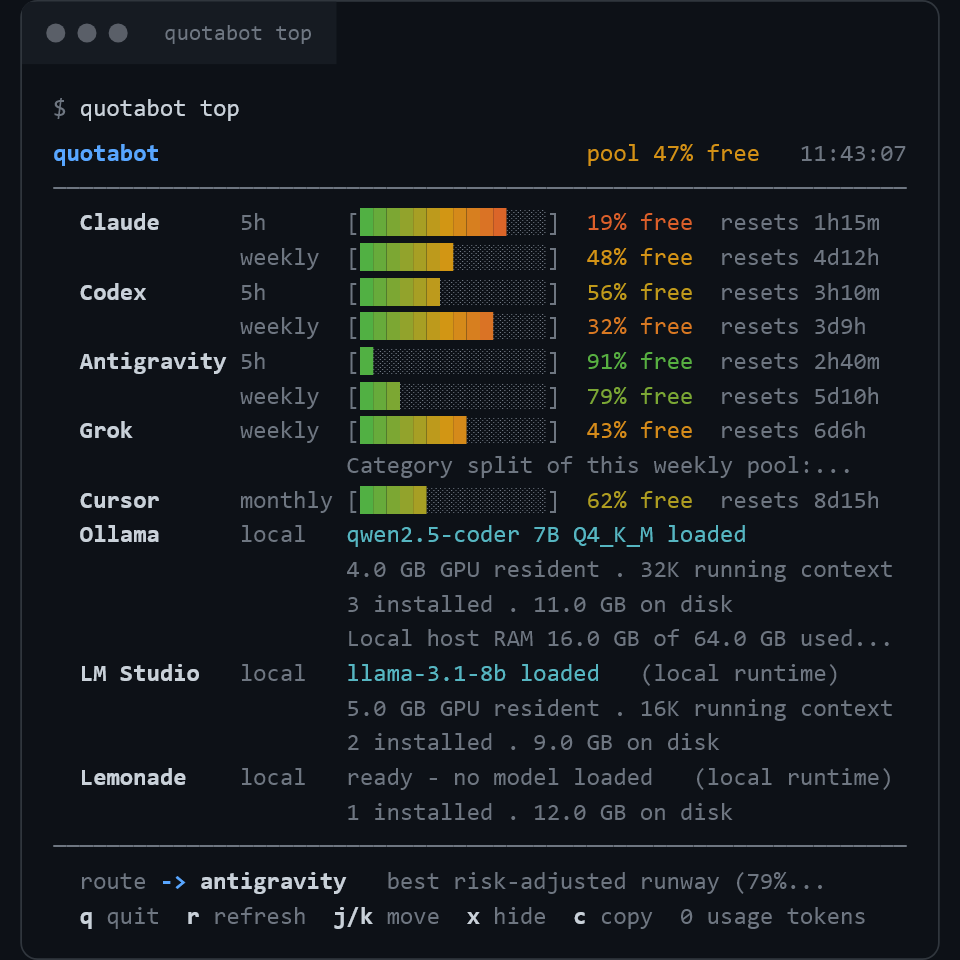

# quotabot

[](https://github.com/blisspixel/quotabot/actions/workflows/ci.yml)
[](LICENSE)

**htop for your agentic-AI quota plans.**

quotabot shows how much included quota remains across AI coding subscriptions
and recommends where to send the next request. It also shows supported local
models, loaded state, context, and available hardware evidence, so you can use
on-device capacity directly or fall back when subscription caps are low.

> **Current stable:** 0.11.11. quotabot remains under active 0.x development.
> **Pending publication:** 0.11.13.
> **Release validation:** the protected 0.11.12 candidate remains unpublished.
> **Next:** confirm a supported Claude quota integration before expanding
> credential discovery, prove account-wide freshness on idle machines through
> a permitted path, and strengthen execution-scope evidence for local-only
> advice. Native signing proceeds alongside product
> development and remains a 1.0 release gate. See [roadmap Next](ROADMAP.md#next)
> and the [documentation index](docs/README.md).

The [October 11 quality review](docs/research/2026-10-11-next-quality-review.md)
checks these priorities against current provider and runtime contracts. Source
0.11.13 pairs bounded MCP stdio with owned Windows pipe cancellation while
preserving legacy negotiation; modern protocol support retains a separate acceptance matrix.

Release notes state each artifact's Windows and macOS signing status. Current
artifacts are unsigned; [signing readiness](docs/RELEASE-SIGNING.md) proceeds
alongside product development.

quotabot is a local advisor, not a proxy. Quota and routing reads make no model
calls, spend no usage tokens, and never read prompts or source code. The CLI
is the complete workflow; the desktop app is optional.

## What it looks like

<table>
  <tr>
    <td width="50%" align="center">
      <a href="docs/gallery/quota.png"></a><br>
      <strong>Quota at a glance</strong><br>
      Remaining allowance and the next available account.
    </td>
    <td width="50%" align="center">
      <a href="docs/gallery/local-models.png"></a><br>
      <strong>Local model detail</strong><br>
      Inspect what is loaded and what the runtime reports.
    </td>
  </tr>
  <tr>
    <td width="50%" align="center">
      <a href="docs/gallery/analytics.png"></a><br>
      <strong>Usage over time</strong><br>
      Compare headroom, reliability and changing demand.
    </td>
    <td width="50%" align="center">
      <a href="docs/gallery/terminal.png"></a><br>
      <strong>The terminal dashboard</strong><br>
      Keep quota advice beside your command-line work.
    </td>
  </tr>
</table>

<p align="center">
  <a href="docs/gallery/mini.png"></a><br>
  <strong>Mini view</strong> - a quiet status strip alongside your work.
</p>

Synthetic demo data, rendered with the real app widgets and terminal renderer.
Click any image for the full size. [Reproduce the gallery](docs/gallery/README.md).

## Quick start

Install the latest checksum-verified CLI release.

**macOS / Linux**

```bash
curl -fsSL https://raw.githubusercontent.com/blisspixel/quotabot/main/install.sh | bash
```

**Windows PowerShell**

```powershell
irm https://raw.githubusercontent.com/blisspixel/quotabot/main/install.ps1 | iex
```

Restart the terminal, then run:

```bash
quotabot doctor
quotabot suggest
```

`doctor` explains stale or unavailable evidence and gives a repair command.
Recent successful Claude reads are shared across processes for up to 30 seconds
with their original capture time, reducing avoidable usage-endpoint throttling.
`live shared` distinguishes this from stale fallback. Add `--fresh` to a quota
read to bypass sharing while retaining provider backoff. Set
`QUOTABOT_MIN_LIVE_INTERVAL` to 0 through 60 seconds to adjust the window.
Sharing requires a current credential and a provider-proven account identity;
other providers retain their existing collection behavior.
`suggest` ranks usable subscriptions and supplies a local fallback when one is
available. Run `quotabot update` to keep the CLI current. If an older install
does not support that command or cannot discover the latest release, run the
installer once more. For inspect-before-run installation, login, updates,
rollback, and uninstall, use the [setup guide](docs/SETUP.md).

## Core commands

| Goal | Command |
|---|---|
| Show the full quota snapshot | `quotabot` or `quotabot --json` |
| Check one provider | `quotabot check claude` |
| Recommend an account with usable quota | `quotabot suggest` |
| Prefer a local runtime | `quotabot suggest --local-first` |
| Preserve an included-quota reserve | `quotabot suggest --quota-stretch` |
| Pick a model for a task | `quotabot suggest --task=hard` |
| Inspect model availability and budget | `quotabot models` |
| Watch quota and routing changes | `quotabot top` or `quotabot watch` |
| Hide a cancelled subscription | `quotabot hide kiro` |
| Require selected reads to be live | `quotabot verify --require-live` |
| Install the latest release for this channel | `quotabot update` |
| Connect an agent to quota advice | `quotabot mcp` |

When provider advice includes a local runtime, it also names a model that
meets a default 32K context heuristic, or explains the shortfall. Running context
and a cold model's advertised maximum remain distinct. This advice does not
change provider eligibility or existing concrete-model ordering. Use
`quotabot suggest --provider-route --min-context=65536` to explicitly gate
provider and fallback eligibility on a different context requirement.

Provider routing is balanced by default. `--local-first` prefers eligible local
runtime candidates immediately. `--quota-stretch` keeps fresh measured included
quota above a reserve before preferring local capacity. Model suggestions use
included quota and local runtimes by default; paid or credit-backed catalog
entries require an explicit `--budget=any` opt-in.
Reported cloud and upstream routes are excluded from local budgets. Positive
execution-scope validation remains [planned work](ROADMAP.md#next): localhost
alone cannot prove that a runtime executes on this machine.

Capability hints describe what a model declares, not measured quality. A model
catalog also cannot establish access through a particular account or harness.
The [September 30 review](docs/research/2026-09-30-review.md) checks current
models, quota/reset policies, local status sources, and routing integrations;
it records the research behind 0.11.7, follow-up source verification, and the
remaining gaps.

See the [usage guide](docs/USAGE.md) for profiles, accounts, model capability
filters, alerts, analytics, drift recovery, routing receipts, and every command.

## Supported sources

Supported cloud and application sources include Claude, Codex, Antigravity /
Gemini, Grok, Cursor, Windsurf / Devin, Kiro, and optional NVIDIA NIM discovery. Cursor
3.x support passively detects an owner-bound local plan, but Cursor does not
persist its current quota pools in the supported local state, so quotabot cannot
yet route on Cursor headroom. Local sources are Ollama, LM Studio, and Lemonade. Their summaries
lead with what is loaded now, the active context limit, and runtime-reported GPU
residency when available; installed count and disk size remain secondary
inventory detail. Bounded host evidence can add RAM, VRAM, and supported GPU
activity without attributing shared machine load to a model. Manual entries
remain explicitly self-reported. Exact endpoints, evidence classes, credential
behavior, and limitations are in [Data sources](docs/DATA_SOURCES.md);
provider-owned cross-checks are in [Provider CLIs](docs/PROVIDER_CLIS.md).

## Desktop app

Portable desktop bundles are published for Windows, macOS, and Linux alongside
the CLI. The app is optional. Each local runtime's **Models** control opens its
inventory with loaded state, reported capabilities, context, and advisory
memory fit. See the [local-model view](docs/USAGE.md#the-desktop-widget).
Windows signing and macOS signing, notarization, and stapling remain pre-1.0
trust gates; each release states its artifacts' signing status.
The grouped Settings dialog includes the installed build, **Check for
updates**, and **Install latest update**. GitHub is contacted only after those
actions. Check shows the latest candidate and latest stable separately.
Install runs the checksum-verified CLI updater. The open tray window is not
replaced by that command. Stable builds recommend stable updates without
hiding newer previews; release candidates follow the preview channel. The app
never checks automatically or prompts on launch.
Verification, launch, update, rollback, and uninstall belong in [Desktop
release bundles](docs/DESKTOP-DISTRIBUTION.md). Source setup and packaging are
in [Building from source](docs/BUILDING.md).

## Agents and integrations

Run `quotabot mcp` with a release CLI from 0.11.0 onward. The MCP server supports
stdio and authenticated loopback HTTP. Its complete
tool and schema contract is in [AGENTS.md](AGENTS.md). See the
[LiteLLM integration](integrations/litellm/) and
[minimal MCP clients](integrations/mcp_clients/) for working examples. The
[harness setup pack](integrations/harnesses/) prints versioned advisory
configuration for OpenClaw, Hermes, and OpenCode 1, with CLI recipes for pi and
NemoClaw. It checks configuration and the quotabot entrypoint; installed-harness
loading remains a separate compatibility check. The
[September harness review](docs/research/2026-09-harnesses.md) records the
versioned OpenClaw, NemoClaw, pi, Hermes, and OpenCode integration plan and its
current limits. Exposing MCP advice does not automatically switch a harness's
model or grant API access through a coding subscription.

For clients that support [Agent Plugins](https://agent-plugins.org/), the
[portable package](integrations/agent_plugin/) supplies the same quota advice
and MCP connection. quotabot reports which configured accounts have usable
included quota; a harness chooses through its supported access under provider
terms. Local-model suggestions are optional, and no integration overrides a
provider limit or silently enables paid fallback.

The [Omarchy widget](integrations/omarchy/) is a separate compact bar panel
for Omarchy 4.0.4. The stable Agents collector cannot show remaining
headroom, freshness, unknown quota, and a recommendation that includes a
local runtime without writing a misleading usage record or switching an
account. The widget reads `quotabot --json` and `quotabot suggest --json`
and keeps credentials out of its display file. It is source in this
repository, not a claim that an Omarchy desktop was installed or that a
release archive was published.

## Privacy and trust boundary

- No quotabot account, hosted service, advertising, or telemetry.
- No model calls or reads of prompts, code, model output, or other user content.
- Local metadata stays local. Live adapters contact only provider quota or
  model-list metadata endpoints; Antigravity may perform required onboarding.
- CLI and desktop update checks read public GitHub release metadata only after
  the user invokes them. They send no quota, account, history, prompt, or code
  data. `quotabot update` installs one exact tag with its required checksum.
- Plain loopback HTTP reads pseudonymize email-shaped account labels unless the
  caller supplies the server's owner-only bearer token. The bundled LiteLLM
  router proves the identity of the exact loopback server connection before it
  sends that token, so exact account routing remains available without trusting
  whichever process happened to bind the configured port first.
- Routing fails soft, so callers can continue if quotabot is unavailable.

Run `quotabot explain` to inspect files and network destinations used by each
adapter. The complete promises and verification methods are in
[Principles](docs/PRINCIPLES.md), [Security](SECURITY.md), and
[Architecture](docs/ARCHITECTURE.md).

## Release and project status

Version [0.11.11](https://github.com/blisspixel/quotabot/releases/tag/v0.11.11) fixes absent-tool discovery,
shares recent successful Claude captures with original age and safe backoff,
and names concrete local models with context and hardware-fit advice. It also
ships the Omarchy widget sources and selected MCP/LiteLLM security updates.
See the [changelog](CHANGELOG.md) and
[October 11 review](docs/research/2026-10-11-issue-review.md) for scope.

The release passed [three-OS main CI](https://github.com/blisspixel/quotabot/actions/runs/38153000563),
[Release workflow](https://github.com/blisspixel/quotabot/actions/runs/38155116920), and
[published Install smoke](https://github.com/blisspixel/quotabot/actions/runs/38159387701).
The immutable 14-asset set contains four CLI and three desktop archive/checksum
pairs. Publication verified exact workflow provenance and fresh downloads.
Published smoke covers clean install, upgrade from 0.11.8, persistent state,
source setup, and stable-channel resolution on Windows, macOS, and Linux.
Desktop checks verify Windows/Linux startup and the installed macOS bundle.

Current Windows and macOS artifacts remain unsigned transition artifacts.
Native publisher signing, supported Claude quota integration, real-account
idle-machine refresh, stronger local execution-scope evidence, and modern MCP
support retain their own acceptance criteria in [roadmap Next](ROADMAP.md#next).
Expanded Claude credential discovery is deferred pending a supported path or
provider confirmation.
Automated readiness and synthetic tests do not establish native assistive
technology interaction or provider-account truth. Build and validation details
are in [Building](docs/BUILDING.md), [Security](SECURITY.md), and the
[documentation index](docs/README.md).

## Disclaimer

quotabot is independent and unofficial. Quota metadata is best-effort; verify
billing and compliance against each provider. Provided "AS IS", without
warranty, under the [Apache License 2.0](LICENSE).
